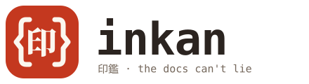

<picture><source media="(prefers-color-scheme: dark)" srcset="https://raw.githubusercontent.com/inkanjs/inkan/main/assets/wordmark-dark.svg"></picture>

An API framework for Node where the docs can't lie.

[](https://www.npmjs.com/package/@inkanjs/inkan)
[](https://github.com/inkanjs/inkan/actions/workflows/ci.yml)
[](LICENSE)

[Docs](https://inkan-dev.vercel.app/docs) · [Benchmarks](https://inkan-dev.vercel.app/benchmarks) · [Hanko](https://inkan-dev.vercel.app/hanko) · [Changelog](CHANGELOG.md)


An *inkan* (印鑑) is the seal a Japanese contract gets stamped with. In inkan every route
has one: its params, query, body, responses and a few examples, written once. From that
inkan checks what comes in, types your handler, trims what goes out, writes OpenAPI 3.1,
serves a docs page and runs the examples as tests.

```ts
import { inkan, problem, t } from "@inkanjs/inkan";

const Tea = t.object({ id: t.int(), name: t.string(), kind: t.enum(["green", "black", "oolong"]) });
const teas = [{ id: 1, name: "Sencha", kind: "green" as const }];

const app = inkan({ title: "Tea Shop", version: "1.0.0" });

app.get(
  "/teas/:id",
  {
    params: t.object({ id: t.int() }),
    response: { 200: Tea, 404: t.problem() },
    examples: [
      { name: "found", params: { id: 1 }, expect: { name: "Sencha" } },
      { name: "missing", params: { id: 99 }, status: 404 },
    ],
  },
  ({ params }) => {
    const tea = teas.find((x) => x.id === params.id); // params.id is a number here
    if (!tea) throw problem(404, "tea-not-found", `There is no tea with id ${params.id}`);
    return tea; // has to be a Tea, or it doesn't compile
  },
);

app.listen({ port: 3000 }); // docs on /docs
```

The examples are what the docs page shows, and they are what `inkan check` runs. If the
404 gets lost in a refactor, the check says so before anyone reads the docs and believes
them:

```sh
$ npx inkan check src/app.ts

  GET    /teas/:id
    ✓ found                              200  0.8ms
    ✗ missing                            200  0.4ms
        answered 200, expected 404

  2 examples · 1 sealed · 1 broken
```

## Getting started

```sh
npm install @inkanjs/inkan
```

You need Node 22 or newer. From 22.18 on, `.ts` files run as they are, without a build step.
The package is scoped because npm keeps the plain name `inkan` free of look-alikes; the
command is `inkan` either way.

`npx @inkanjs/inkan examples` gives you six explained projects to look at and start from.

To start a project of your own:

```sh
npm create inkan@latest my-api
npm create inkan@latest my-api -- --store postgres --auth --frontend next
```

It asks where the data lives (memory, Postgres, Redis, MongoDB or MySQL), whether you want
logins, and whether a Next.js or Vite frontend goes with it, then writes a project that
passes `inkan check` and its own tests, with a CI workflow. `npx @inkanjs/inkan create app`
is the same command; `--help` lists the options.

## What's in it

The core has no dependencies. Besides the contracts, it comes with:

- a typed client for the frontend, built from the app itself, with no generated code
- the docs page at `/docs` and the OpenAPI document at `/openapi.json`
- a live request inspector at `/_inkan` while you develop
- one error format for everything, [RFC 9457](https://www.rfc-editor.org/rfc/rfc9457) problems
- server-sent events, streams, file uploads and CSV, all under the contract
- WebSockets with a contract per message, and background jobs with progress and schedules
- hooks, plugins and decorators, and `inkan diff` to tell which changes break clients, in
  the terminal, as JSON or as Markdown for a pull request comment
- `inkan seal`, which compiles contracts to plain code ahead of time, without `eval`

It runs on `node:http`, and on Bun, Deno and serverless through `app.fetch`. Auth,
sessions, stores for Redis, Postgres, MongoDB and MySQL, and the other official plugins
live in [inkanjs/middleware](https://github.com/inkanjs/middleware); the Next.js, Vite,
TanStack Query and uWebSockets.js integrations in
[inkanjs/integrations](https://github.com/inkanjs/integrations).

Everything else is in [the docs](https://inkan-dev.vercel.app/docs).

## Compared to the others

Express gets out of your way, Fastify is fast, Hono runs everywhere. inkan is closest to
Fastify in spirit, with schemas on every route, but it keeps the docs and the tests in the
same place as the code, and it gets its speed without generating code at runtime.

On the benchmark (twelve scenarios on a GitHub runner, plain `node:http` as 100) inkan
scores 89.4, Fastify 87.2, Hono 82.5 and Express 46.1. That puts inkan a little ahead of Fastify
in every run, though not in every scenario. The numbers, how they are measured and how to run
the bench yourself are on [the benchmarks page](https://inkan-dev.vercel.app/benchmarks).
I wrote the other frameworks' apps myself, so if you know a faster way to write one of
them, please open a pull request.

## Stability

Since 0.8 the API is stable. What is marked stable won't be removed or change meaning in a
minor release; a rename keeps the old name working, with a warning, for at least two minor
releases and six months. A few newer parts, like jobs and WebSockets, are still marked
experimental. The details are in [docs/STABILITY.md](docs/STABILITY.md).

## How inkan is made

I'm Vensin, and I design and maintain inkan on my own. A lot of the code is written
together with an AI assistant (Claude Code). None of it goes in unchecked: I read every
change, run it on my own hardware and put it through a security review before it's merged.
Every change comes with tests, about 450 of them, and every example in the docs is one
of them. I make mistakes too, and this is how I try to catch them before you do.

Issues and pull requests are welcome.

## License

[MIT](LICENSE)
